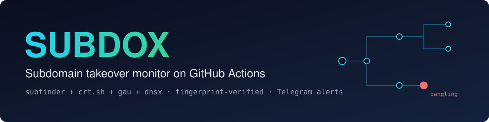
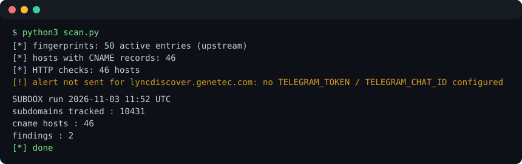

<p align="center"></p>

<p align="center">
  <a href="LICENSE"></a>
  <a href="https://github.com/chsxthwik/SUBDOX/actions/workflows/check.yml"></a>
  <a href="https://github.com/chsxthwik/SUBDOX/actions/workflows/scan.yml"></a>
  
  <a href="https://github.com/chsxthwik/SUBDOX/commits/main"></a>
</p>

SUBDOX watches your domains for **subdomain takeovers**. It runs on GitHub Actions every six hours, enumerates subdomains, checks their CNAMEs against the [can-i-take-over-xyz](https://github.com/EdOverflow/can-i-take-over-xyz) fingerprints, verifies the evidence, and sends a Telegram message once per finding. No server needed.

## Features

- Five discovery sources: subfinder (passive), crt.sh, gau (archives), dnsx brute force, and permutations.
- Captures CNAMEs for hosts that do not resolve to an IP. That is exactly where dangling records hide.
- Evidence-based alerts: NXDOMAIN, HTTP status or body marker must actually match.
- Each finding alerts once. State lives in SQLite under `data/` and is committed back by the workflow.
- Works without Telegram: findings are still recorded and alert on the first run after you add secrets.

## How it works

```
domains.txt
    |
    v
subfinder -all ...... 30+ passive OSINT sources
crt.sh .............. certificate transparency (fallback)
gau ................. wayback / archive URLs
dnsx bruteforce ..... 110k-word DNS wordlist (SecLists), A-resolution
perms.py ............ level-1 permutations (dev-api., api-dev., ...)
    |
    v  merged, deduped: data/subs-latest.txt
dnsx -cname ......... CNAME capture over the FULL candidate list
    |
    v  data/cnames.txt
scan.py ............. fingerprint match (can-i-take-over-xyz DB)
                      + dangling-CNAME detection + HTTP body verification
    |
    v
SQLite state ........ each finding alerts exactly once
Telegram ............ [TAKEOVER] / [REVIEW] / [DANGLING] to your phone
```

The design point that matters: **dnsx captures CNAME records directly, including hosts that don't resolve to an IP.** A dangling CNAME (your target's subdomain pointing at a service record that no longer exists) is exactly the takeover condition, and A-record resolvers like massdns output would silently drop it.

## Why each finding is trustworthy

The fingerprint DB is pulled fresh every run (with `fingerprints.json` as an offline fallback) from [can-i-take-over-xyz](https://github.com/EdOverflow/can-i-take-over-xyz) . A finding fires only when the evidence actually checks out:

- `NXDOMAIN` fingerprints: the CNAME target must really return NXDOMAIN
- HTTP fingerprints: the page body must actually contain the provider's unclaimed-marker string (fetched live, https then http)
- `HTTP_STATUS=xxx` fingerprints: the status code must match

Severity tags: `[TAKEOVER]` = vulnerable service, evidence matched. `[REVIEW]` = edge case (may be exploitable, needs eyes). `[DANGLING]` = unknown CNAME pointing at a dead target, no fingerprint match - manual review, still often the most interesting finding you'll get.

## Setup (10 minutes)

1. Fork or copy this repo (private is fine; see runtime budget below).

2. Telegram bot:
   - message `@BotFather` -> `/newbot` -> copy the token
   - message `@userinfobot` -> copy your chat id

3. Repo **Settings -> Secrets and variables -> Actions**, add:
   - `TELEGRAM_TOKEN`
   - `TELEGRAM_CHAT_ID`

4. Edit `domains.txt` - one root domain per line. You must own or have permission to test these. Commented lines are skipped.

5. Actions tab -> enable workflows -> run **subdox** once manually (`workflow_dispatch`) to sanity-check. It then runs every 6 hours via cron.

State lives in `data/` (SQLite + text snapshots) and is committed back after every run, so the bot's memory survives restarts. Check `data/last-scan.json` for a human-readable view of the latest run; the Actions summary page shows per-run stats.

## Runtime budget

Typical run: 8-20 minutes depending on target size. Scheduled runs at minute 17 of every 6th hour = ~120 runs/month. At ~15 min each that's ~1,800 Action minutes - inside the 2,000 free minutes for private repos. If you scan many domains, make the repo public (unlimited minutes) or lower the cron frequency.

## Tuning (all optional env vars on the scan step)

| Var | Default | Meaning |
|---|---|---|
| `SUBDOX_HTTP_CAP` | 3000 | max HTTP body checks per run |
| `SUBDOX_HTTP_WORKERS` | 32 | concurrent HTTP fetches |
| `SUBDOX_DNS_WORKERS` | 50 | concurrent DNS lookups |
| `SUBDOX_DANGLING_ALERTS` | 1 | alert on unknown dangling CNAMEs |
| `SUBDOX_NEW_SUB_ALERTS` | 0 | daily-style digest of newly seen subdomains |
| `SUBDOX_PERM_CAP` | 200000 | permutation candidate cap |

## Honest limits

- No passive scanner sees 100% of subdomains. Private/internal DNS is invisible from outside - that's physics, not a tool gap. Passive + archive + brute + permutations is the realistic ceiling.
- Brute force runs via dnsx A-resolution. Wildcarded domains produce some garbage candidates, but they're harmless: only CNAME-bearing names with matching fingerprint evidence can ever fire an alert.
- Telegram secrets aren't set? The scan still completes and findings are recorded in SQLite - alerts fire on the first run after you add the secrets.
- Body fingerprints that are too generic (e.g. a bare "404 Not Found") are ignored unless the CNAME also matches the provider - otherwise every nginx 404 page on the internet would page you. The tradeoff: a couple of ambiguous services won't auto-fire; the `[DANGLING]` path still catches their dead CNAMEs.
- A `[TAKEOVER]` alert means "claimable per fingerprint evidence". Before reporting a bug bounty finding, register/claim and prove it - never report from the alert alone.

## Troubleshooting

- **Run red at the enum step**: one source dying is normal and tolerated; a red run means something bigger - check the first failing line (usually a tool download; release URLs are pinned in `scan.yml`).
- **No Telegram message**: secrets unset, wrong chat id, or you never pressed *Start* in your bot's chat first. Send any message to your bot once.
- **Want more depth**: bump `SUBDOX_PERM_CAP`, or swap the brute list URL in `scan.yml` for a bigger SecLists file - the pipeline doesn't care.

## Legal

Only scan domains you own or are authorized to test. You are responsible for how you use this tool.

## Development

```bash
pip install -r requirements.txt
python -m unittest discover -s tests -v   # unit tests, no network needed
python3 scan.py                           # uses data/cnames.txt and data/subs-latest.txt
```

`python3 scan.py` against the committed `data/` prints something like:

<p align="center"></p>

The `data/` directory is written by the scheduled workflow (`scan: update state [skip ci]` commits). Do not edit it by hand.

## License

[MIT](LICENSE)
